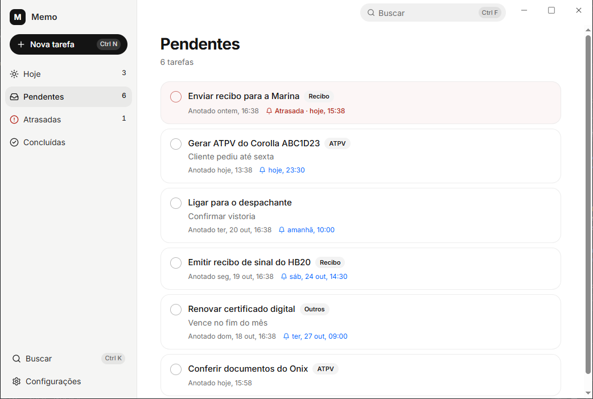

# Memo

Small task reminder app for Windows. Lives in the tray, fires native notifications, works fully offline.

Built with Tauri 2, React and SQLite.

<picture>
  <source media="(prefers-color-scheme: dark)" srcset="docs/screenshot-dark.png">
  
</picture>

## Download

Grab the installer from [Releases](https://github.com/prxtenses/memo-reminders/releases/latest). Windows 10/11, no admin needed. You only download it once: Memo checks for new versions and offers to update itself.

## Features

- Reminders that fire even with the window closed (the app stays in the tray)
- Dates typed right in the title: `Pay invoice dia 25`, `Call João amanhã 10h`, `em 30 min`
- Global quick capture (`Ctrl+Alt+N`) and an always-on-top scratch pad (`Ctrl+Alt+B`)
- Views: Today, Pending, Overdue, Done
- Light/dark theme, command palette (`Ctrl+K`)
- Daily automatic backup + JSON export/import
- Self-updating from GitHub Releases

## Running

You need Node 22.6+, Rust, and the Visual Studio C++ Build Tools.

```
npm install
npm run tauri dev
```

Tests: `npm test`

## Building

```
npm run tauri build
```

The installer ends up in `src-tauri/target/release/bundle/nsis/`. It isn't code-signed, so SmartScreen will warn on first run.

If the project sits inside OneDrive, point the build somewhere else (OneDrive locks files mid-build):

```
$env:CARGO_TARGET_DIR = "$env:LOCALAPPDATA\Memo-build"
```

## Data

- Database: `%APPDATA%\com.memo.desktop\memo.db`
- Backups (last 7 days): `%LOCALAPPDATA%\com.memo.desktop\backups`

Uninstalling keeps your data.

## Shortcuts

| Keys | Action |
|---|---|
| Ctrl+Alt+N | Quick capture (anywhere in Windows) |
| Ctrl+Alt+B | Scratch pad (anywhere in Windows) |
| Ctrl+N | New task |
| Ctrl+K | Command palette |
| Ctrl+F | Search |
| Ctrl+1…4 | Switch view |
| Ctrl+Shift+L | Toggle theme |
| Delete | Delete task (undo available) |
